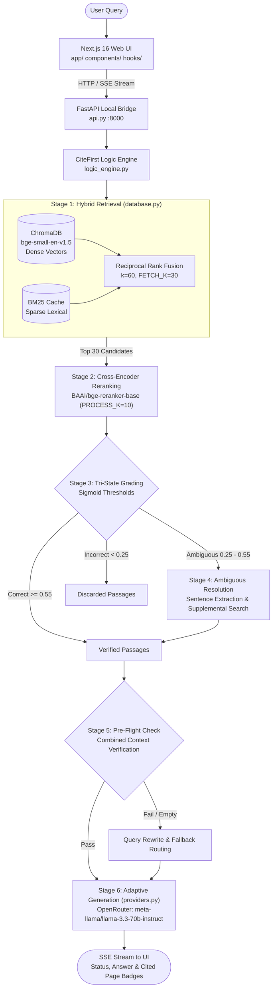

<div align="center">

<h1>CiteFirst</h1>
<p><strong>Research Assistant with Citations</strong></p>
<p>Ask questions across your PDF papers. Inspect the passages behind each answer and open citations at the source PDF page.</p>

<p>
  <a href="https://github.com/Qusai7-04/CiteFirst/actions/workflows/ci.yml"></a>
  
  
  
</p>

<p>
  <a href="#explore-the-app">Explore</a> ·
  <a href="#architecture-overview">Architecture</a> ·
  <a href="#quickstart">Quickstart</a> ·
  <a href="#evaluation-benchmark--verified-results">Evaluation</a> ·
  <a href="#api">API &amp; configuration</a>
</p>

</div>

---

## The idea

CiteFirst is a **citation-grounded research assistant**. You load your own PDF papers, ask a question in plain English, and it:

1.  **Finds** the most relevant passages across all your papers (dense vectors + keyword search).
2.  **Judges** each passage with a second, stricter model and throws away weak ones.
3.  **Double-checks** that the surviving passages really answer your question *before* writing anything.
4.  **Answers** using only that evidence, with the **PDF filename and page number** for every source.
5.  **Lets you click through** to the original PDF, opened at the cited page.

Everything about your papers (text, embeddings, metadata) stays **on your machine**. Only the final prompt goes to the LLM provider (OpenRouter).

---
## Explore the app

Start the app (see [Quickstart](#quickstart)), then explore these pages at `http://127.0.0.1:3000`:

| Page | What you can do there |
| :--- | :--- |
| **`/`** Home | Animated landing page with a quick-ask box, pipeline overview, feature grid and a link to the metrics |
| **`/chat`** Chat | Ask questions with a history sidebar. Edit a past question or regenerate an answer. Attach a PDF from the chat box. Focus on one paper. Export the chat to PDF. Click a source card to open the PDF at the cited page |
| **`/vault`** Vault | Upload, list and delete the papers CiteFirst searches |
| **`/pipeline`** Pipeline | Watch the pipeline stages light up live while a query runs |
| **`/analytics`** Analytics | Run the retrieval evaluation and see evidence-gated metrics |
| **`/settings`** Settings | Tune retrieval and grading thresholds with sliders, save, or reset to defaults |

<details>
<summary><strong>What happens when you ask a question?</strong></summary>

1. Hybrid search collects candidate passages from the indexed PDFs.
2. A cross-encoder reranks them; confidence thresholds classify them as correct, ambiguous, or incorrect.
3. The pipeline resolves ambiguous evidence, then checks whether the combined context addresses the question.
4. When the first search is insufficient, it can rewrite the query and retry.
5. The response includes a pipeline status and any available source PDF/page references for you to inspect.

</details>

---
## Architecture Overview




---

## The Six Pipeline Stages

CiteFirst implements corrective retrieval-augmented generation across six modular stages:

1. **Stage 1 — Hybrid Retrieval (Dense + BM25 + RRF)**:
   - **Dense vector search**: `BAAI/bge-small-en-v1.5` embeddings (384 dimensions) stored locally in ChromaDB.
   - **Sparse lexical search**: BM25 corpus matching with query tokenization and in-memory caching.
   - **Reciprocal Rank Fusion (RRF)**: Merges dense and sparse rankings to collect an initial candidate pool of 30 chunks (`FETCH_K=30`).
   - **Parent-Child Expansion**: Chunks are scored at focused sentence level (100 words), while enclosing parent chunks (350 words) provide paragraph context for the generator.
2. **Stage 2 — Cross-Encoder Reranking**:
   - `BAAI/bge-reranker-base` cross-encoder evaluates joint query-passage cross-attention.
   - Predictions are batched for high-throughput CPU inference. Top 10 passages (`PROCESS_K=10`) are normalized via sigmoid scaling.
3. **Stage 3 — Tri-State Grading**:
   - Candidate chunks are categorized into three confidence tiers:
     - **Correct** (score ≥ 0.55): Directly accepted into verified evidence context.
     - **Ambiguous** (0.25 ≤ score < 0.55): Forwarded to ambiguous resolution.
     - **Incorrect** (score < 0.25): Discarded as irrelevant noise.
4. **Stage 4 — Ambiguous Resolution**:
   - Extracts the highest-scoring sentence from ambiguous chunks and runs targeted supplemental searches to rescue or discard candidate passages.
5. **Stage 5 — Pre-Flight Combined Relevance Verification**:
   - Evaluates whether the combined set of verified passages sufficiently answers the user query before invoking generation, mitigating hallucination and false positives.
6. **Stage 6 — Adaptive Citation-Grounded Generation**:
   - Passes verified evidence to OpenRouter LLMs (`meta-llama/llama-3.3-70b-instruct` by default).
   - Generates responses anchored to the provided context with structured citations (source PDF filename, 1-based physical PDF page number, and evidence snippets).

<details>
<summary><strong>Pipeline details and response statuses</strong></summary>

The default candidate pool is `FETCH_K=30`; `PROCESS_K=10` limits reranked passages. New-vault grading defaults are `CORRECT_THRESHOLD=0.55` and `AMBIGUOUS_THRESHOLD=0.25`. Older, uncustomized settings can retain legacy thresholds; the effective values are visible in `/settings`.

| Status | Meaning |
| :--- | :--- |
| `success` | Evidence passed the pipeline's checks on the initial search |
| `fallback_success` | A rewritten question found usable evidence |
| `partial_match` | Related evidence was found, but the match is incomplete |
| `failed` | The pipeline found no evidence that met its criteria |

These labels describe the route through the pipeline, **not a human verdict on factual correctness**.

</details>

---

## Quickstart

**You need:** Python 3.10–3.14 · Node.js 18+ · a free [OpenRouter API key](https://openrouter.ai/keys)

### Step 1: Start the backend (Python)

```bash
git clone https://github.com/Qusai7-04/CiteFirst.git
cd CiteFirst

python -m venv .venv          # creates an isolated Python environment
```

<details>
<summary><b>🪟 Windows (PowerShell)</b></summary>

```powershell
.\.venv\Scripts\Activate.ps1
pip install -r requirements.txt
copy .env.example .env
```
</details>

<details>
<summary><b> macOS /  Linux</b></summary>

```bash
source .venv/bin/activate
pip install -r requirements.txt
cp .env.example .env
```
</details>

Open the new `.env` file and paste your key:

```env
OPENROUTER_API_KEY=sk-or-v1-your-key-here
OPENROUTER_MODEL=meta-llama/llama-3.3-70b-instruct
OPENROUTER_BASE_URL=https://openrouter.ai/api/v1
```

Run the server:

```bash
python -m uvicorn api:app --host 127.0.0.1 --port 8000 --reload
```

**Check it works:** open <http://127.0.0.1:8000/api/health>. You should see `"status": "ok"`.

### Step 2: Start the frontend (Node.js)

In a **second terminal**, in the same folder:

```bash
npm install
npm run dev
```

Open <http://127.0.0.1:3000>. Keep the backend running, because the web app forwards every `/api/*` call to it.

### Step 3: Ask your first question

- [ ] Go to **`/vault`** and upload one or more PDF papers
- [ ] Go to **`/chat`** and ask something about them
- [ ] Click a **source card** to open the PDF at the cited page and verify the answer
- [ ] Watch the stages live on **`/pipeline`**

> [TIP]
> The first query is slow. The embedding and reranker models load on first use, and reranking on a CPU is the slowest step (the benchmark averaged about 36 s per query for retrieval plus reranking).

---

## Evaluation Benchmark & Verified Results

CiteFirst was evaluated against its local benchmark corpus of **66 academic research papers** (7,816 chunks).

### 1. Chunk-Level Relevance Evaluation

Evaluated using an LLM Grader (`meta-llama/llama-3.1-8b-instruct`) on the 66-paper corpus across **593 chunk-level relevance classifications**:

- **Accuracy**: **0.9848**
- **Precision**: **0.7000**
- **Recall**: **0.8235**
- **F1 Score**: **0.7568**

#### Confusion Matrix (593 Chunk Decisions)

| | Predicted Irrelevant | Predicted Relevant | Total Decisions |
| :--- | :---: | :---: | :---: |
| **Actual Irrelevant** | **570** (True Negatives) | **6** (False Positives) | 576 |
| **Actual Relevant** | **3** (False Negatives) | **14** (True Positives) | 17 |
| **Total Predictions** | 573 | 20 | **593** |

> [IMPORTANT]
> **Understanding Chunk Relevance vs. Answer Correctness**:
> The high accuracy (98.48%) is driven primarily by the large true-negative denominator (570 correct rejections of irrelevant passages out of 593 total decisions; 570 + 6 + 3 + 14 = 593). This measures the chunk filter's ability to reject distractor passages. **It does NOT represent the accuracy of generated answers.**

### 2. Answer-Accuracy Evaluation (Human Review)

Answer correctness was evaluated across **26 human-reviewed questions** with signed evidence sign-offs and structured verdict forms, partitioned into 22 development questions and a disclosed 4-question pilot:

| Partition | Questions | ACCEPT | PARTIAL | REJECT | Claim Coverage (Covered / Partial / Omitted) | Approved Pages in Context |
| :--- | :---: | :---: | :---: | :---: | :---: | :---: |
| **Development (Q001–Q022)** | 22 | **2 (9.1%)** | **9 (40.9%)** | **11 (50.0%)** | 14 / 21 / 39 (N=74) | 15 / 22 |
| **Disclosed Pilot (Q023–Q026)** | 4 | **4 (100.0%)** | **0 (0.0%)** | **0 (0.0%)** | 9 / 0 / 0 (N=9) | 4 / 4 |
| **Overall Benchmark Total** | **26** | **6 (23.1%)** | **9 (34.6%)** | **11 (42.3%)** | **23 / 21 / 39 (N=83)** | **19 / 26** |

#### Key Evaluation Findings
- **Context Presence vs. Claim Synthesis**: In 19 of 26 questions (73.1%), approved source pages successfully reached the generation context. However, multi-part synthesis requirements caused the generator to miss secondary claims or output cautious abstentions.
- **Pilot Generalizability Caveat**: The pilot questions (Q023–Q026) were inspected during prompt tuning; their 4/4 acceptance rate is disclosed as an internal pilot and must not be interpreted as an unbiased general holdout rate.

### 3. Historical Ablation Study

The table below reflects the progressive ablation findings from the initial research study:

| Configuration | Accuracy | Precision | Recall | F1 Score | Notes |
| :--- | :---: | :---: | :---: | :---: | :--- |
| **Dense-only baseline** (no logic) | 0.938 | 0.390 | 0.760 | 0.514 | High noise, low precision |
| **Hybrid dense + BM25 / RRF** | 0.885 | 0.380 | 0.860 | 0.525 | Higher recall, broader pool |
| **Hybrid + Cross-Encoder** (static thresholds) | 0.910 | 0.480 | 0.720 | 0.576 | Reranker sharpens top ranks |
| **Full Logic + Chunk-level verification** | 0.974 | 0.500 | 0.670 | 0.572 | Early gate reduced true positives |
| **Full Logic + Pre-flight combined check** | **0.985** | **0.700** | **0.820** | **0.760** | Final architecture; cuts false positives |


For detailed protocols, cryptographic manifests, and signed verdict sheets, see the [Pipeline Evaluation & Benchmark Report](docs/evaluation/evaluation_report.md) and [`docs/evaluation/phase4_questions.json`](docs/evaluation/phase4_questions.json).

---

## API 


The backend is a normal REST API. Explore and try every route in the interactive docs at <http://127.0.0.1:8000/docs>.

| Method | Route | Purpose |
| :---: | :--- | :--- |
| `GET` | `/api/health` | Is the pipeline loaded? (`ok` or `degraded`) |
| `POST` | `/api/query` | Ask a question, get the full result in one response |
| `POST` | `/api/query/stream` | Same, but streams stage updates live (Server-Sent Events) |
| `GET` | `/api/vault/list` | List indexed papers |
| `POST` | `/api/vault/upload` | Upload and index a PDF |
| `GET` | `/api/vault/document/{filename}` | View a stored PDF in the browser |
| `DELETE` | `/api/vault/delete/{filename}` | Remove a paper and its chunks |
| `GET` / `PUT` | `/api/settings` | Read or save pipeline settings |
| `POST` | `/api/evaluate` | Start a retrieval evaluation, returns a `task_id` |
| `GET` | `/api/evaluate/{task_id}` | Poll that evaluation |

**Try it** (`-N` keeps the stream open so you see each stage arrive):

```bash
curl -N -X POST http://127.0.0.1:8000/api/query/stream \
  -H "Content-Type: application/json" \
  -d '{"question": "What problem does this paper solve?"}'
```

<details>
<summary><b> Request and response shapes</b></summary>

**Request body**

| Field | Type | Notes |
| :--- | :--- | :--- |
| `question` | string | Required |
| `file_filter` | string or null | Optional. A PDF filename to restrict the search to one paper |

**Stream events:** a series of `data: {"step": "...", "detail": "..."}` lines (steps: `fetching`, `reranking`, `resolving`, `generating`), ending with:

```json
{ "step": "done", "result": { "status": "success", "answer": "...", "facts": [], "sources": [], "evidence": [], "query_used": "..." } }
```

> On Windows PowerShell, use `curl.exe` and escape the quotes, or just use the `/docs` page.
</details>

---

## Configuration

### Environment variables (`.env`)

| Variable | Required | Default | What it does |
| :--- | :---: | :--- | :--- |
| `OPENROUTER_API_KEY` | ✅ | none | Your OpenRouter key |
| `OPENROUTER_MODEL` | | `meta-llama/llama-3.3-70b-instruct` | Model used for every LLM step unless overridden below |
| `OPENROUTER_BASE_URL` | | `https://openrouter.ai/api/v1` | API endpoint |
| `ANSWER_MODEL` | | same as `OPENROUTER_MODEL` | Model for sentence extraction and the final answer |
| `LIGHT_TEXT_MODEL` | | same as `OPENROUTER_MODEL` | Model for the quick helper steps (pre-flight check, query rewrite, supplemental search) |
| `CITEFIRST_VECTOR_DIR` | | `./vector_vault` | Where the ChromaDB index lives |

### Pipeline knobs (`settings.json`, or the `/settings` page)

| Setting | Default | What it controls |
| :--- | :---: | :--- |
| `FETCH_K` | 30 | Candidates pulled by hybrid retrieval |
| `PROCESS_K` | 10 | Passages kept after reranking |
| `CHUNK_WORD_LIMIT` | 300 | Max words of a passage shown to the grader |
| `CORRECT_THRESHOLD` | 0.55 | Score at or above this counts as  correct |
| `AMBIGUOUS_THRESHOLD` | 0.25 | Score at or above this (but below correct) counts as  ambiguous |
| `BENDY_THRESHOLD` | 0.10 | Minimum score for a partial-match answer |
| `MAX_VERIFIED_CHUNKS` | 2 | Hard cap on evidence passed to the LLM |
| `SOFTMAX_MASS_CUTOFF` | 0.90 | How much probability mass the adaptive selector keeps |
| `DISTANCE_THRESHOLD` | 0.70 | Pre-filter on vector distance |


---

## Project structure

```text
CiteFirst/
├── api.py                  # FastAPI bridge: REST + streaming
├── logic_engine.py         # The corrective pipeline (stages 2–6)
├── database.py             # PDF ingestion, chunking, ChromaDB, BM25, RRF (stage 1)
├── providers.py            # OpenRouter client with retries and clear error messages
├── settings_config.py      # Loads settings.json over built-in defaults
├── settings.json           # Tunable thresholds
├── evaluator.py            # Retrieval evaluation harness
├── evaluation/             # Dataset auditing and ranking metrics
├── phase4_diagnostics.py   # Opt-in retrieval trace (never used by the app)
├── upload_papers.py        # Bulk-upload papers/ through the running API
├── scripts/                # Benchmark and worksheet runners
├── reviewed_dataset.json   # Historical 18-question baseline
├── docs/evaluation/        # Report, methodology, signed verdicts, manifests
├── tests/                  # Offline backend test suite
├── app/                    # Next.js pages: / /chat /vault /pipeline /analytics /settings
├── components/             # UI: chat, home, layout, pipeline, settings, vault, analytics
├── hooks/  lib/  types/    # Frontend helpers and TypeScript types
└── .github/workflows/      # CI (backend tests + frontend lint, types, build)
```

---

## Development

```bash
# Backend: full offline test suite (no API key or model downloads needed)
pip install -r requirements-test.txt
python -m pytest -q tests

# Backend: syntax check
python -m compileall -q api.py database.py logic_engine.py providers.py settings_config.py

# Frontend
npm run lint
npx tsc --noEmit
npm run build
```

GitHub Actions runs all of the above on every push and pull request.

---

## Security and scope

- **Local, single-user tool.** The backend binds to `127.0.0.1:8000` and the frontend to `127.0.0.1:3000`. CORS only allows those local origins.
- **No login system.** There is no authentication or multi-user isolation. Don't expose it to a network without an authenticating reverse proxy.
- **Hardened uploads.** Filenames are validated, and path traversal and symlinked paths are rejected.
- **Your keys stay in `.env`**, which Git ignores. Only `.env.example` is committed.

---

## FAQ / Troubleshooting

<details>
<summary><b>The health check says <code>degraded</code></b></summary>

The pipeline modules failed to load, so the API is answering with stub responses. Check the backend terminal for the import error, then re-run `pip install -r requirements.txt` inside your activated virtual environment.
</details>

<details>
<summary><b>"OPENROUTER_API_KEY not found or not configured"</b></summary>

Your `.env` still has the placeholder (`PASTE_YOUR_...`) or is missing. Paste your real key and restart the backend.
</details>

<details>
<summary><b>Errors 401, 402, 404 or 429 from OpenRouter</b></summary>

- **401:** the key is wrong or revoked.
- **402:** your OpenRouter account is out of credits.
- **404:** the model name in `OPENROUTER_MODEL` doesn't exist on OpenRouter.
- **429:** rate limit hit. CiteFirst retries a couple of times automatically before giving up.
</details>

<details>
<summary><b>I get  "No reliable evidence"</b></summary>

CiteFirst found nothing it trusts, which is by design. Try rephrasing the question with the paper's own terminology, make sure the right paper is in the vault, or lower the thresholds on `/settings`.
</details>

<details>
<summary><b>The web page loads but nothing answers</b></summary>

The frontend forwards `/api/*` to `http://127.0.0.1:8000`. Make sure the backend is running on that port, and open the site via `localhost:3000` or `127.0.0.1:3000`, since other origins are blocked.
</details>

<details>
<summary><b>New to RAG? A mini glossary</b></summary>

- **RAG (retrieval-augmented generation):** look up relevant text first, then let an LLM answer using only that text.
- **Embedding:** a list of numbers that captures a passage's meaning, so similar meanings land close together.
- **BM25:** classic keyword scoring, good at exact terms and names.
- **RRF (Reciprocal Rank Fusion):** a simple way to merge two ranked lists into one.
- **Cross-encoder / reranker:** a model that reads the question and a passage *together* to judge relevance more accurately, but more slowly.
- **Sigmoid score:** a 0–1 confidence number derived from the reranker's raw output.
- **SSE (Server-Sent Events):** how the backend streams live progress to your browser.
- **ChromaDB:** the local database that stores the embeddings.
</details>

---

## Lineage and attribution

CiteFirst grew out of the **CRAG-Pipeline** university research project on Corrective RAG at the Manipal Institute of Technology, created by **Sushant Shekhar Sinha**, **Kanan Gupta** and **Qusai** ([original repo](https://github.com/Sushant-py/CRAG-Pipeline)). The citation-grounding architecture, evaluation framework, security hardening and ongoing maintenance live in this repository. See [`NOTICE.md`](NOTICE.md) for full attribution and permissions.

**Licensing:** CiteFirst intentionally has no root `LICENSE` file. All rights are reserved by the authors. Third-party libraries, research papers and model weights (ChromaDB, PyMuPDF, SentenceTransformers, Hugging Face models) remain under their own licenses.
